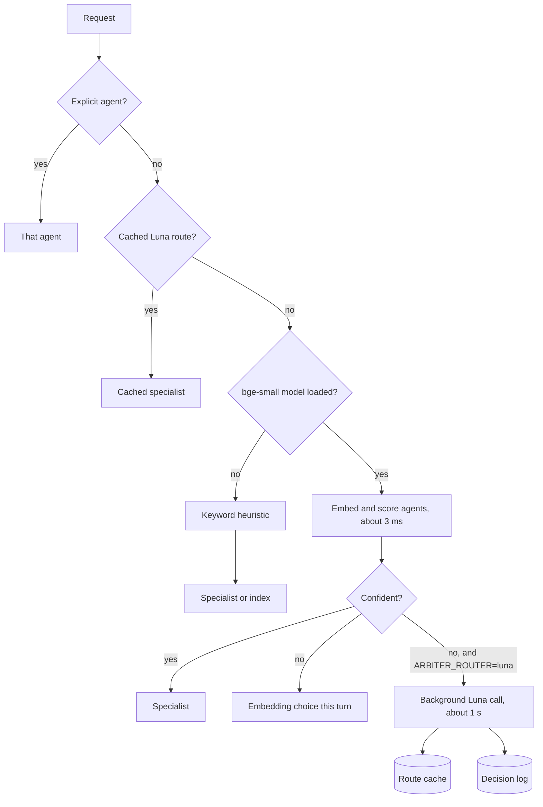
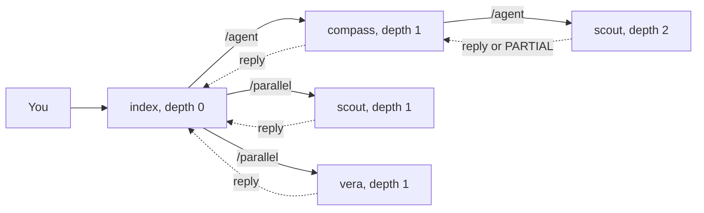
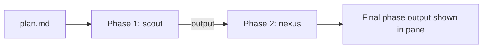

<p align="left">
  
</p>

# Arbiter

A local-first, multi-agent runtime for the terminal, written in C++.

Arbiter routes each request to the right specialist agent, lets agents delegate to
each other, and keeps a separate model in the loop to check the work. It's one binary
with your agents defined as JSON files, and model calls go to OpenRouter or a local
Ollama. I built it because I wanted an agent harness I could read end to end, with the
routing, supervision, and tool permissions in the runtime instead of in a prompt I
have to trust.


## Install

macOS (Apple silicon) and Linux x86_64:

```bash
curl -fsSL https://raw.githubusercontent.com/tylerreckart/arbiter/main/install.sh | sh
arbiter --version
```

The installer verifies the release checksum. It installs to `/usr/local/bin` unless
you set `INSTALL_DIR`, and it only uses `sudo` when that directory isn't writable.
Set `ARBITER_VERSION=vX.Y.Z` to pin a release.

**From source.** You need a C++20 compiler, CMake 3.20+, OpenSSL, libcurl, and SQLite3.
Configure downloads pinned, checksummed copies of ONNX Runtime and the OpenTUI core,
so the first build needs network access. Distro packages are listed in
[CONTRIBUTING.md](CONTRIBUTING.md).

```bash
git clone https://github.com/tylerreckart/arbiter.git && cd arbiter
cmake -B build -DCMAKE_BUILD_TYPE=Release
cmake --build build
sudo cmake --install build
```

## Quickstart

```bash
export OPENROUTER_API_KEY="sk-or-..."   # or put it in ~/.arbiter/openrouter_api_key
arbiter --init                          # writes the starter agents and themes to ~/.arbiter/
arbiter                                 # opens the TUI
```

Type a request. The router sends it to a specialist, or to the built-in master agent
`index`, which answers or delegates. The starter agents are `scout` (research), `vera`
(code review), `quill` (writing), `forge` (infra/ops), `nexus` (backend), `loom`
(frontend), `compass` (planning), `beacon` (marketing), `echo` (social), and `jules`
(presence).

To get one reply for a script, use one-shot mode. It prints the reply to stdout, exits
non-zero on error, and can't run `/exec`:

```bash
arbiter --send vera "review: if (arr.length = 0) return;"
git diff | arbiter --send vera "$(cat)"
```

Ollama works too: give an agent a model id that starts with `ollama/` and set
`OLLAMA_HOST` if Ollama isn't at `localhost:11434`. Run `arbiter --setup-tools` to set
up web search, browsing, and MCP servers.

## Core features

### Intent routing

Before a fresh request reaches `index`, Arbiter picks the specialist that should handle
it. The default router is bge-small-en-v1.5, a local int8 ONNX embedding model that
runs inside the process with no network call. It compares the request against each
agent's `role`, `goal`, and `routing_examples`. When it's confident, that's the route.
When it isn't, that choice is still the route for this turn. Luna
(`openai/gpt-6-luna` logprob classification over OpenRouter) checks the same text in
the background only when `ARBITER_ROUTER=luna`. Luna's answer is cached for similar
requests and logged next to the embedding's choice. If the model is missing, the
download fails, or `ARBITER_EMBED_NO_FETCH` is set, the keyword heuristic decides
and Luna does not start.



You can improve routing for your own agents by adding examples:

```jsonc
// ~/.arbiter/agents/scout.json (excerpt)
"routing_examples": [
  "find primary sources on X",
  "what's the current state of research on Y?"
]
```

On a 59-item routing eval, the keyword heuristic scored 31%, bge-small scored 81% at
about 3 ms, and Luna scored 92% at about 1 s. Use `ARBITER_ROUTER=bge|luna|heuristic`
to choose the router (default `bge`). The model (~34 MB) downloads to
`~/.cache/arbiter/models/` on first use and is checked against a pinned SHA-256. Set
`ARBITER_EMBED_NO_FETCH=1` to skip the download. Routing decisions (`intent_route`,
`intent_decision`) go to `~/.arbiter/tui.log`. Details:
[docs/concepts/intent.md](docs/concepts/intent.md).

### Delegation and parallel agents

Agents call other agents the same way they call tools, by writing a command inside
their reply:

```
/agent scout find the three most-cited papers on retrieval-augmented generation

/parallel
/agent scout survey the current options
/agent vera review src/router.cpp for thread-safety issues
/endparallel

/pane quill draft release notes from CHANGELOG.md
```

`/agent` waits for the reply. `/parallel` runs its children concurrently and returns
when they've all finished. `/pane` opens a detached peer in its own pane. Every
subagent gets a `[DELEGATION CONTEXT]` header with the original request, who delegated
to it, its depth, and the shared memory and open todos. Nesting stops at depth 2 by
default (`ARBITER_MAX_DELEGATION_DEPTH`). If a subagent runs out of tool rounds, its
work comes back marked `[PARTIAL: …]` instead of being thrown away.



A depth-2 agent can't delegate again. It gets `ERR: delegation depth limit reached`.

### Plans

`compass` inspects the workspace, then writes a phased plan to `plan.md`.
`/plan execute` runs that plan in order, passing each phase's output to the phases
that depend on it. Phases use this format:

```markdown
### Phase 1: Survey
**Agent:** scout
**Task:** Find how other CLIs version their config files.

### Phase 2: Design
**Agent:** nexus
**Depends on:** 1
**Task:** Propose a config-file schema and migration path.
```

```
/agent compass plan adding a versioned config file to this repo
/plan execute plan.md
```



A phase that runs out of tool rounds keeps its partial output, and the plan continues.
A cancelled or failed phase stops the plan. A `direct` phase runs a shell command
and goes through the same `/exec` confirmation as an agent.

### Agents, constitutions, and the advisor

An agent is a JSON file, called its constitution, in `~/.arbiter/agents/<id>.json`. It
sets the model, goal, rules, and `capabilities`, which is a hard allowlist of the
commands the agent may run. It can also name an advisor: a separate, usually stronger
model that checks the agent's work.

```jsonc
// ~/.arbiter/agents/critic.json
{
  "name": "Critic",
  "role": "code-reviewer",
  "model": "anthropic/claude-sonnet-5",
  "goal": "Find real bugs before they ship.",
  "rules": ["Cite file and line for every finding."],
  "capabilities": ["/read", "/list", "/map", "/exec", "/mem", "/lesson", "/advise"],
  "routing_examples": ["review this diff", "is this function correct?"],
  "advisor": { "model": "anthropic/claude-opus-5", "mode": "gate", "max_redirects": 2 },
  "max_turns": 8
}
```

In `gate` mode, the advisor reviews each final answer with no history (just the
original task, the final text, and a summary of the tool calls) and replies with one
of these signals:

```
<signal>CONTINUE</signal>
<signal>REDIRECT</signal><guidance>Add a failing test first.</guidance>
<signal>HALT</signal><reason>The change deletes user data without a backup.</reason>
```

`REDIRECT` sends the agent back to work with the guidance. `HALT` stops the turn and
shows the reason in the TUI. The agent can't skip the gate, and an unreadable advisor
reply counts as `HALT` by default (`malformed_halts`). In `consult` mode, the agent
asks the advisor on its own with `/advise <question>`, up to 2 times per turn. See
[docs/concepts/advisor.md](docs/concepts/advisor.md) and
[data-model.md](docs/concepts/data-model.md).

### Presence

A presence agent stays loaded and watches other agents work. After a peer's batch of
tool calls, it can add one short note to that peer's next step, or stay silent. It
can't halt the work or grade it. That's the advisor's job. `jules` is the bundled
example:

```jsonc
"presence": { "mode": "always_on", "watch": ["*"], "interject": "context", "max_notes_per_turn": 1 }
```

In the TUI, a note looks like this:

```
↳ presence · jules  Scout already fetched the v2 contract; reuse it instead of searching again.
```

At most 3 watchers run per check, and an error counts as silence. See
[docs/concepts/presence.md](docs/concepts/presence.md).

### Lessons and loop detection

This is the "self-improving" part. When an agent works out how to fix a failure, it
writes it down:

```
/lesson /fetch behind cloudflare: use Authorization-bearing fetch, not plain GET
```

Before each top-level turn, the runtime finds lessons that match the prompt and puts
the top 3 at the top:

```
[KNOWN PITFALLS — your prior lessons]
  - [/fetch behind cloudflare] use Authorization-bearing fetch, not plain GET (#14)
[END KNOWN PITFALLS]
```

Lessons belong to one agent and stay in `tenants.db`. Lessons that keep getting used
move up the list. Within a turn, if the same tool call fails twice in a row, the
runtime adds a `[LOOP DETECTED]` block that tells the agent to change its approach.
See [docs/concepts/lessons.md](docs/concepts/lessons.md).

### Memory, scratchpads, and todos

Agents share a typed graph of facts in SQLite that lasts across conversations.
Entries have a type (`project`, `reference`, `learning`, …) and links to each other.
Search matches on text first, and type and tag matches raise an entry's score. A fact that stops being
true is retired with `/mem invalidate`, which ends its validity window instead of
deleting it.

```
/mem add entry reference OpenRouter logprobs support (checked 2026-10)
Luna returns one top_logprobs entry; require_parameters=true 404s.
/endmem
/mem search luna logprobs
/mem add link 88 supports 89
```

Each agent also has a scratchpad (`/mem write <text>`, `/mem read`), and
`/mem shared write` writes to one every agent can see. `/todo add`, `/todo start <id>`,
and `/todo done <id>` keep a task list, and subagents see the open todos when work is
delegated to them. See
[docs/concepts/structured-memory.md](docs/concepts/structured-memory.md) and
[todos.md](docs/concepts/todos.md).

### Tools, capabilities, and exec safety

Agents act by writing slash commands, called writs, as plain lines in their reply.
There's no JSON tool-calling schema. The runtime picks them up from the stream, runs
them, and returns the results on the next turn. Commands inside fenced code blocks are
ignored.

| Area | Writs |
|---|---|
| Read the world | `/read`, `/list`, `/map`, `/fetch`, `/search`, `/browse` |
| Change it | `/write`, `/exec` |
| Other agents | `/agent`, `/parallel`, `/pane`, `/advise` |
| Remember | `/mem`, `/todo`, `/lesson` |
| Integrations | `/mcp`, `/a2a`, `/schedule` |

If a writ isn't in the agent's `capabilities`, it doesn't run. `/exec` splits the
command into arguments and runs it with `posix_spawnp`, without a shell. Plain commands
like `git status` or `npm test` run right away. Anything riskier waits for you to
confirm:

```
/exec git status                 runs
/exec python3 scripts/migrate.py asks: HOST SHELL (unsandboxed) — destructive command
/exec cat log | grep ERR         asks (shell syntax)
```

The full model is in [Safety model](#safety-model).

### Tool-loop budget

Each turn gets a fixed number of model calls that can use tools: 6 at the top level and
12 for subagents. Override it per agent with `max_turns` or for every agent with
`ARBITER_MAX_TURNS`. With one round left, the agent sees `1 tool round left; finish
up`. If it still runs out, Arbiter makes one last call with tools turned off, so the
agent writes its best answer. A subagent's parent gets that answer, or the partial
work marked `[PARTIAL: …]`, instead of a bare error. Turns that finish within the
budget take no extra calls.

## TUI: theming and configuration

**Layout.** Each pane is a conversation with its own agent. Split with `^W v` (vertical)
or `^W h` (horizontal). On terminals 96 columns or wider, a right-hand rail shows:

- **Fleet**: a tree of every agent in the current job. Names come first, followed by a
  short status (`read`, `wait`, `fail`) or a token count, plus a detail line for the
  selected agent.
- **Session**, **Agent**, **Todos**, and **Tools** sections underneath.

A left sidebar (`^W t`) lists past conversations.

**Keys:**

| Key | Action |
|---|---|
| `Esc` | Cancel the focused pane's turn |
| `PgUp` / `PgDn` | Scroll the focused pane (`fn`+`↑` is PgUp on compact keyboards) |
| `^O` | Expand or collapse the thinking, tool, or code block in view |
| `^W v` / `^W h` / `^W c` / `^W z` | Split vertically, split horizontally, close, zoom |
| `^W w` | Move to the next pane |
| `^W f` | Open the Fleet pane. In Fleet: `j`/`k` move, `Enter` opens that agent's pane, `x` cancels its turn, `Esc` leaves Fleet without cancelling |
| `^W b` / `^W t` / `^W s` | Pick a conversation / toggle the history sidebar / toggle the session sidebar |
| `↑` / `↓` | Input history |

Permission and diff cards use `↑`/`↓` and `Enter`, or the shortcuts `y`/`n` and
`a`/`r`/`A`. Click to focus, expand, or resize when `layout.mouse` is on (the default).

**Themes.** About a hundred presets are built into the binary, including nord,
dracula, gruvbox, catppuccin, tokyo-night, and solarized. The default is
`high-contrast`.

```
arbiter --theme nord          launch with a preset
/theme                        browse with live preview
/theme save mine              save the current look to ~/.arbiter/themes/mine.json
```

To make your own theme, start from an exported preset or put overrides on top of one in
`~/.arbiter/tui.json`. Colors are `#RRGGBB` hex.

```bash
arbiter --export-theme high-contrast > ~/.arbiter/themes/mine.json
```

```json
{
  "preset": "nord",
  "accent": { "primary": "#c678dd" },
  "content": { "accent_prompt": "#88c0d0" },
  "layout": { "show_footer": false, "mouse": true },
  "component": { "footer_right": "/help" }
}
```

`content.accent_prompt` colors your input and the bar next to your sent messages. The
token groups are `bg`, `text`, `accent`, `border`, `content` (markdown, code, diffs,
the agent palette), `layout` (padding, breakpoints, sidebars, footer, mouse), and
`component` (prompt and footer strings). See
[docs/tui/themes.md](docs/tui/themes.md).

**Glyphs.** `ARBITER_GLYPHS=unicode|ascii|auto` sets the status marks (`●` `◌` `✓` `✗`
`↳`). `auto`, the default, switches to ASCII on a non-UTF-8 locale or when
`TERM=dumb`.

**Logs.** While the TUI is open, stderr goes to `~/.arbiter/tui.log`, so log lines don't
end up in your prompt. The file is truncated when it passes 1 MiB. Look there for
`intent_route`, provider responses, and warnings.

**Other settings:** `ARBITER_THEMES_DIR` (load themes from a directory during
development), `ARBITER_AUTOSAVE_INTERVAL_SEC` (default 30), `ARBITER_COMPACT_THRESHOLD`
(auto-compact at this percent of the context window, default 75), and `--no-exec`.
The full reference is in [docs/tui/](docs/tui/index.md).

## Configuration

Everything Arbiter stores is under `~/.arbiter/`: `agents/*.json`, `themes/`,
`tui.json`, `tui.log`, your OpenRouter key, and `tenants.db` (conversations, memory,
lessons, and todos). The agent schema is in
[docs/concepts/data-model.md](docs/concepts/data-model.md).

| Variable | What it does |
|---|---|
| `OPENROUTER_API_KEY` | Key for hosted models |
| `OLLAMA_HOST` | Ollama address (default `http://localhost:11434`) |
| `ARBITER_ROUTER` | `bge` (default), `luna`, or `heuristic` |
| `ARBITER_EMBED_NO_FETCH` | Don't download the router model; the keyword heuristic routes that turn |
| `ARBITER_MAX_TURNS` | Tool rounds per turn (default 6 at the top level, 12 for subagents) |
| `ARBITER_MAX_DELEGATION_DEPTH` | How deep `/agent` can nest (default 2) |
| `ARBITER_GLYPHS` | `unicode`, `ascii`, or `auto` |
| `ARBITER_SANDBOX_IMAGE` | Run `/exec` in a Docker container |

The full list is in [docs/cli/environment.md](docs/cli/environment.md).

## Safety model

- **No shell by default.** `/exec` splits the command into arguments and runs it
  directly with `posix_spawnp`, without a shell.
- **Confirmation for anything risky.** The TUI asks before running pipes, redirects,
  command substitution, destructive commands like `rm`, and any interpreter running a
  script or code string (`bash`, `python`, `node`, `go run`, `deno`, `awk`, and so on,
  including through `env` or an absolute path).
- **Capabilities are enforced.** If a command isn't on an agent's `capabilities` list,
  the runtime won't run it, however the agent is prompted.
- **`--send` can't exec, and neither can `--api` by default.** The server needs
  `ARBITER_SANDBOX_IMAGE` (a per-tenant Docker container with no network) or an
  explicit `--allow-host-exec`. `--no-exec` turns `/exec` off in the TUI.
- **Writes are reviewed.** In the TUI, `/write` asks first, and agent diffs are
  proposals you apply with `/diff`.

Without a sandbox, `/exec` in the TUI runs on your machine as you. The confirmation
prompt is a speed bump, not a sandbox. See [docs/concepts/sandbox.md](docs/concepts/sandbox.md)
and [SECURITY.md](SECURITY.md).

## Stability

From 1.0 on, these follow semver: CLI flags, agent file fields, the `~/.arbiter/`
layout, and documented `ARBITER_*` environment variables. The HTTP server (`--api`),
tenants, A2A, reconcile, the scheduler, and voice are experimental. They ship and
work, but they may change in a minor release. See [docs/stability.md](docs/stability.md).

## License

[Apache 2.0](LICENSE)
