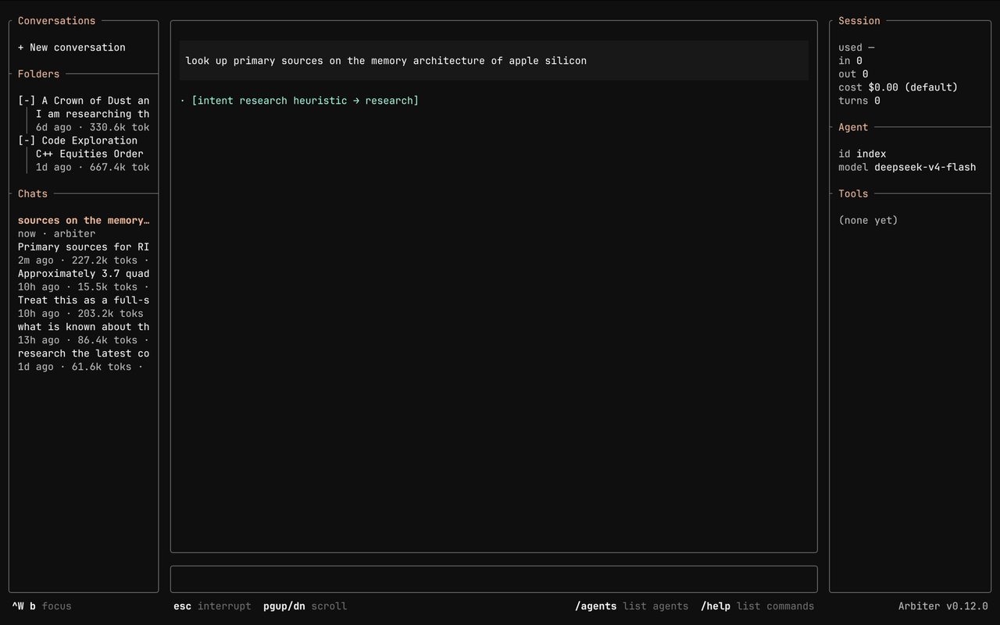

<p align="left">
  
  <h1 align="left">Arbiter</h1>
  <p align="left">
    A self-improving intent engine for autonomous work.
    <br> Local-first; network optional.
    <br><br>
    <a href="#about">About</a>
    ·
    <a href="https://github.com/tylerreckart/arbiter/releases/latest">Download</a>
    ·
    <a href="docs/getting-started/local.md">Documentation</a>
    ·
    <a href="CONTRIBUTING.md">Contributing</a>
  </p>
</p>



## About

Arbiter is a multi-agent orchestration harness built to be secure, durable, and event-driven. While there are many excellent agent frameworks available, they often force you to choose between strict tool limits, durable memory, or real-time event routing. Arbiter provides all three.

The Arbiter runtime is a thin, event-streaming orchestration and intent engine for building agent specialists and integrating real-time reasoning functionality (such as routing webhooks and sensor data via glob matching). Anyone can use the runtime to own their harness and embed strict, constitution-driven agents into their own applications—without duct-taping a chat CLI to someone else's API. Arbiter's long-term goal is become a deterministic runtime for autonomous work. 

## One Event Model Everywhere

| Mode | Command | For |
|------|---------|-----|
| Interactive | `arbiter` | Multi-pane TUI, global conversation store |
| Remote TUI | `arbiter --connect <url>` | Same TUI as a thin client of a remote `arbiter --api` |
| One-shot | `arbiter --send <agent> "..."` | Scripts, cron, CI |
| Server | `arbiter --api` | HTTP+SSE API, tenant-isolated, A2A v1.0 |

One binary. Shared storage under `~/.arbiter/`. Provider keys (OpenRouter, Ollama, …) are the only external dependency for model calls.

## Quick start

```bash
curl -fsSL https://raw.githubusercontent.com/tylerreckart/arbiter/main/install.sh | sh

arbiter # local TUI
```

Linux binaries, source builds, Ollama, `--send`, `--api`, and `--connect` are in
[getting-started/local](docs/getting-started/local.md).

## Documentation

- [`docs/getting-started`](docs/getting-started/local.md) — first agent reply
- [`docs/philosophy`](docs/philosophy.md) — why Arbiter is shaped this way
- [`docs/api/`](docs/api/index.md) — HTTP API, tenants, SSE, MCP, A2A, memory
- [`docs/cli/`](docs/cli/index.md) — `--init`, `--send`, `--api`, `--connect`, env vars
- [`docs/tui/`](docs/tui/index.md) — panes, keybindings, themes, sessions
- [`docs/stability.md`](docs/stability.md) — what 1.0 will freeze
- [`CHANGELOG.md`](CHANGELOG.md) · [`CONTRIBUTING.md`](CONTRIBUTING.md) · [`SECURITY.md`](SECURITY.md)

> [!WARNING]
>
> Arbiter is preparing a 1.0 freeze. The contract that tag will keep
> stable is [docs/stability.md](docs/stability.md). Until that tag,
> anything that page marks experimental can still change. TUI `/exec`
> is [unsandboxed by default](docs/concepts/sandbox.md) (confirm-gated
> host shell; set `ARBITER_SANDBOX_IMAGE` for Docker). 

Licensed under the [Apache License 2.0](LICENSE).
